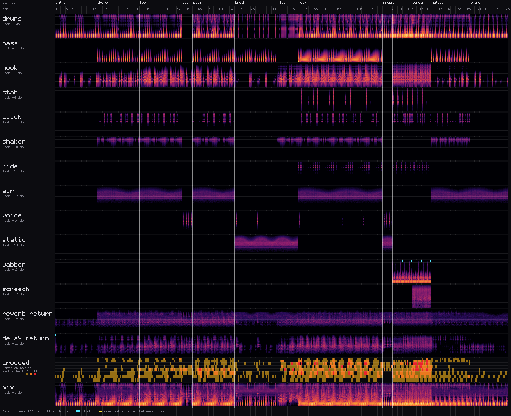

# The command line

`tatum <command>`; `tatum help` prints the short version of this page. With cargo,
`cargo run --release -p tatum-cli -- <command>`.

| command | what it does |
|---------|--------------|
| [`check`](#check) | compile a song and report errors and design warnings, without sound |
| [`render`](#render) | render a song to a WAV, with a report of the mix |
| [`play`](#play-and-watch) | play a song on the audio device |
| [`watch`](#play-and-watch) | play it, and play every save of the file on the next bar |
| [`debug`](#debug) | render every part apart, with spectrograms and a report of clicks and mud |
| [`audit`](#audit) | measure every note of every tonal track for what is not its harmonics |
| [`analyze`](#analyze-and-compare) | measure a reference track: tempo, key, the kick, the spectrum, density |
| [`compare`](#analyze-and-compare) | a reference and your song side by side, and what in the file moves each difference |
| [`events`](#events) | one sound's events read from the inside, or two files side by side: attack, decay, Q, purity, level in the mix, tail, and what should not be in a render |
| [`design`](#design) | design any sound -- a graph or a module -- in the browser, against a record's kick, and keep it in `sounds/` |
| [`set`](#set) | render, check, gate and play a live set |
| [`tui-shot`](#tui-shot) | a picture of the live screen at any second |
| [`params`](#params) | every module parameter, its range and units |
| [`fmt`](#fmt) | rewrite knob positions in their units |

Every command that reads a song resolves its `use "..."` lines first, so a song
built on a rig compiles as one file.

## check

```
tatum check song.synth
```

Parses and compiles, and prints what is wrong with the line it is on and a suggestion.
Then the design warnings: things that compile and will not sound the way they read,
like a track ducked by a sidechain in a scene with no kick. They are listed in
[DSL.md](DSL.md#design-warnings). It exits 1 on an error, 0 with warnings.

## render

```
tatum render song.synth [-o out.wav] [--bars N] [--solo a,b] [--mute c]
```

Renders the whole arrangement to a WAV (`output.wav` by default; `--bars N` renders
only the first N bars).
Every song leaves at -18 LUFS with its true peak limited at -1 dB, after the master
chain. On the way it prints the mix: each track's peak, RMS, crest, width and band, the
tracks that share a band at a similar level, each section's loudness against the
loudest, and what the master chain did to the peaks. At the end it lists what it heard
that sounds wrong: clicks, tracks that do not go quiet between notes. How to read that
report is in [MIX.md](MIX.md#reading-a-mix).

## play and watch

```
tatum play  song.synth [--tui] [--device <name>] [--rate <hz>] [--midi <name>] [--buffer <frames>]
tatum watch song.synth [--tui] [--device <name>] [--rate <hz>] [--midi <name>] [--buffer <frames>]
tatum midi monitor [<song.synth> | <set dir> [--step N]] [--midi <name>]
tatum midi list
```

`play` plays the song on the default output device until it ends or you type `q`.
`watch` does the same and plays every save of the file. A value edit applies at once.
Anything else takes over on the next bar, keeping every tail and voice the edit did not
touch, and a save that does not compile is reported while the last good version keeps
playing. A song without `scene` and `arrange` loops: that is a live set in one file.
See "Livecoding semantics" in [DSL.md](DSL.md#livecoding-semantics).

- `--device <name>` picks the output device; `--list-devices` lists them.
- The engine renders at 44.1 kHz. A device that only offers another rate, as every
  Bluetooth headphone does at 48 kHz, gets the output resampled; `--rate` forces one.
- A MIDI controller plays the song through its `midi { }` block: knobs and faders on
  parameters, the keys on a track, the pads on drums. Every MIDI input is read unless
  `--midi` names one; `--list-midi` lists them. See [DSL.md](DSL.md#midi-knobs-keys-and-pads).
- `--tui` runs full screen; `--glass` is the same for a terminal with translucent cells.
  See [TUI.md](TUI.md).
- `--buffer 1024` asks the device for that many frames a callback, for headroom when
  its default leaves too little.
- `tatum midi monitor` prints every message a controller sends (notes, pads, knobs, the
  pitch strip, aftertouch, program changes) with its channel and bytes, and, given a
  song or a set, what its `midi` block, zones and trigger keys do with it: the way to
  find out what a controller really sends before mapping it. `i` on the live screen
  shows the same.

On exit both print the worst audio callback time against its budget, and how many
dropouts the device reported.

## debug

```
tatum debug song.synth [--bars N | A-B] [--dry] [-o dir] [--solo a,b] [--mute c]
```

For finding where a noise comes from. It renders once with every track, bus and send
return kept apart, each as it sits in the mix, and writes into
`test_output/debug/<song>/` (or `-o`):

- a WAV and a spectrogram per part;
- `sheet.png`, all of them stacked on one time axis over the mix, with a "crowded"
  strip where three or more parts pile up on the same range;
- `report.txt`: clicks (and which fall on a section change), tracks that do not go
  quiet between notes, energy below 25 Hz and fizz above 16 kHz, each with its bar,
  and per section each part's level against the loudest and which parts sit level
  with each other on top of the same range;
- `zoom.*.png`, the worst moment of each part up close, its wave and its spectrum.

`--bars 17-24` zooms in on those bars; `--dry` adds each track before its insert chain.



## audit

```
tatum audit song.synth [--bars N] [--json] [--strict]
```

Renders every tonal track on its own and dry, and reports per note how much of its
energy is not at a harmonic of the note the pattern asked for. That finds two things:
a note going wrong against the other notes of the same voice, and an effect dirtying a
whole voice, by rendering it with and without each effect. The absolute number is a
fingerprint of a timbre and means nothing next to another track's. `--json` prints the
same numbers for a script; `--strict` exits 1 if anything is reported. More in
[MIX.md](MIX.md#auditing-a-mix).

## analyze and compare

```
tatum analyze reference.wav [--from 1:04] [--to 1:36]
tatum compare reference.wav song.synth [--from S] [--to S] [--bars N | A-B] [--solo a,b] [--mute c]
tatum compare reference.wav other.wav
```

A record named as a reference is a word to whoever writes the song, and more so to a
model, which cannot hear it or its own render. `analyze` turns it into numbers: the
tempo (and its span when it moves), the key, the notes under 250 Hz, the loudness and
how far the peaks sit over it, the width above 250 Hz and under 150 Hz, the spectrum per
octave against the whole, and the kick -- the frequency it hits at, the note its sweep
lands on, the note it is heard as (the sweep weighted by its loudness), how long the
sweep takes, how long the body holds and then falls (all timed from the hit), how much click, and how much else fills its band. It reads a WAV from 8 to 384 kHz, PCM or float; an MP3 has to be converted
first (`ffmpeg -i song.mp3 song.wav`). `--from`/`--to` take a stretch, in seconds or
`m:ss`. At most 15 minutes are measured at once, enough for a long extended mix; a longer
file, such as a DJ set, is refused with a pointer to `--from`/`--to`, and only the stretch
picked is ever converted.

What it says about `dark_techno` rendered, the engine's own song:

```
dark_techno.wav: 300.7 s
  tempo        137.0 BPM (137..150)
  key          F minor / G# major, weakly: little in it is tonal
  low notes    D# 19%, E 14%, G 10%   (under 250 Hz, the kick's tail included)
  loudness     -18.0 LUFS, peak -1.2 dBFS, peak to loudness 16.8 dB
  width        3% above 250 Hz, 0.1% under 150 Hz
  kick         1016 hits, measured on the 50 with the least under them
    hit        89 Hz (the first half cycle)
    tail       39.0 Hz (D#1)
    sweep      33 ms to within 10% of the tail
    heard      43.8 Hz (F1), +2.0 semitones from the tail: the sweep weighted by its loudness
    hold       none: it falls from the hit
    decay      -12 dB at 95 ms, -24 dB at 111 ms
    click      -26.5 dB (first 10 ms over 2 kHz against the body)
    under it   -45.6 dB (the band under 400 Hz late in the beat)
  spectrum     31.5    63   125   250   500    1k    2k    4k    8k   16k
  (dB)         -2.2  -7.0 -10.9 -12.6 -16.7 -19.5 -22.9 -21.1 -21.3 -22.6
```

The kick is measured on every hit averaged together, so the bass, the pads and the reverb
under its tail cancel and the kick is left; and only on the hits with the least else in
its band late in the beat, which in a track made for DJs are the intro and the outro,
where the kick plays alone. A bass that starts with every kick is locked to it and
survives the average; when one fills the band throughout, the report says so and the
tail and the decay are not to be trusted -- point `--from`/`--to` at a stretch where the
kick plays alone. The tail is measured on the stretch where the kick is within 12 dB of
its peak, and when the sweep is still falling there, from where it is heading: a pitch
sweep is an exponential towards its end note. A sweep that lands in a few milliseconds
is quicker than a cycle, so `hit` reads lower than where it starts. The key comes with
its relative, which has the same notes; the two cannot be told apart by the notes alone.

`compare` measures your song the same way (rendered as `render` renders it, or a second
WAV) and prints both side by side, then what differs by enough to hear, each with what in
the file moves it: the note to put at the end of `pitch_osc`'s sweep, the factor for the
sweep's decay and the body's `perc`, the octave bands to take down or bring up, the
density, the low end's width, the tempo. Loudness itself is not compared: every song
leaves the engine at -18 LUFS and a record is mastered far louder. How far the peaks sit
over the loudness is, because that is the density a master hears as punch, and it comes
from saturating, clipping and compressing the drums, not from the level. `--solo drums`
compares the kit alone against the record's kick; `--bars` picks the stretch of the song,
counted as `debug` counts it, each scene at its own tempo, and a first bar past the end is
an error. `--bars`, `--solo` and `--mute` pick parts of a song, so with a second WAV they
are an error rather than ignored; that WAV is measured whole.

## events

```
tatum events a.wav [--from 1:04] [--to 1:36] [--band LO HI] [--min-gap MS] [--threshold DB]
                   [--sustained] [--first N] [--png sheet.png] [--show N] [--json]
tatum events a.wav --against b.wav [--b-from S] [--b-to S] ...
```

`analyze` and `compare` measure a mix, and a kick on its grid. `events` measures one
sound: what each of its events is like inside, and how it sits in what runs under it.
Pings, bubbles, a drop, a struck bell are on no grid, and two renders can match in when
their events come, where they start and how long they last and still not sound alike:
one clicks at the start and the other does not, one rings pure and the other carries
noise, one sits 12 dB over its bed and the other inside it. Those are numbers too.

An event is found where the spectrum in a band jumps over its own floor -- the level each
bin sits at a tenth of the time, so a pad or a reverb underneath is floor -- and followed
along its strongest partial until that partial is back in the floor. The band is where
the onsets are unless `--band` gives one. Each event is then demodulated by its own
partial, which leaves its level and pitch sample by sample however far it glides:

| row | what it is |
|---|---|
| attack 10-90% | milliseconds from a tenth to nine tenths of the peak, in a band from an octave under the partial to two over |
| burst over the resonance | the energy above 1.5 times the partial's frequency in the first 5 ms, less what the bed puts there and what the partial's own onset spreads there, against the energy at the partial: a click or a noise burst at the start reads high |
| fall to -20 / -40 dB, decay | from the peak; the decay in dB per millisecond of the event's first stage (the line through its fall to -10 dB, carried on while the fall stays within 2 dB of it, at most 30 dB), and how straight the first 30 dB are in dB (1 is an exponential) |
| start pitch, end pitch, bend | the partial's frequency, and the shape of the way between: flat, straight, fast then slow, slow then fast, arch, dip; a vibrato's rate and depth when there is one. The bend is over the stretch above -20 dB |
| -3 dB width, Q | of the partial with its glide taken out; and the Q a resonator needs to ring with the decay read (pi f tau) |
| partial over the rest | the partial against everything else the event adds to the spectrum -- the bed just before it taken off bin by bin, and the partial's own skirt (from its attack and decay) taken off what lies beside it: noise, other partials, splatter. Clean reads high |
| 2nd, 3rd harmonic | against the partial, the bed and the partial's skirt taken off the same way |
| over the bed, against the mix | the partial at its peak over what was in its own band just before it; and against the mix over the second around it, its own span left out |
| left over right, side over mid, correlation | where the event sits; side against mid in its band (the width: a mono event has no side); and the correlation of the two channels' signals in its band (an inter-channel delay of a quarter period reads 0) |
| tail | the energy in the partial's band from 50 to 400 ms after its decay is 20 dB down, beyond what that decay itself still leaves there (the decay's own model put through the same band), against the event: reverb, or a second slower stage. A dry event of any decay has none |
| centroid | of what the event adds over the bed, at its peak, and how far it has moved when the partial is 12 dB down |
| repeats | echoes: the interval, the first repeat against the event, and what each repeat after loses; a repeat has to be a quieter copy of the event, shaped like it |

Each row is the median over the events with the quarter either side, then the first
events one by one. With fewer than three events, or with `--sustained`, what holds is
measured as well: the spectrum in third octaves, the partials of the steadiest stretch
with how far and how fast each one's level and pitch move, beats, how much the spectrum
changes from frame to frame, the width per octave. And always, what should not be in a
render: partials folded back from above Nyquist (looked for where harmonic `k` of each
event's note would land, `rate - k f`, less what is beside it), DC, steps in the wave,
a modulation that moves in stairs, a tone left in the quiet -- each in dB under the
signal, with where.

The tom of `sounds/node_kit.synth` rendered alone (`tatum render sounds/node_kit.synth
--solo tom -o tom.wav`). Its patch says what to expect: a sine that drops from 157 Hz onto
98 Hz within 45 ms, 20 dB down at 131 ms and 40 at 238 (0.19 dB/ms between). The tool reads
the decay at 0.18 dB/ms, the end at 98.8 Hz, and of the start only that it is above 127 Hz
(one event 153): the drop is faster than it reads a start from. What it cannot read here it
says, and why:

```
tom.wav: 7.7 s, 4 events in 38-532 Hz (where the onsets are), 0.52 a second
                                   median   25%..75%                n
  over its floor                  77.4 dB   77.4..77.5              4
  length                     not measurable here: its level falls and rises again after its peak (a second strike, or partials beating)
  attack 10-90%                 < 5.18 ms   under its floor         4
  burst over the resonance   not measurable here: its level falls and rises again after its peak (a second strike, or partials beating)
  fall to -20 dB             not measurable here: its level falls and rises again after its peak (a second strike, or partials beating)
  fall to -40 dB             not measurable here: it does not fall that far before it ends
  decay                        0.18 dB/ms   0.18..0.18              3
  decay straightness                 0.63   0.63..0.63              3
  start pitch                    > 127 Hz   past what is read       3
  end pitch                       98.8 Hz   98.7..98.9              4
  bend                         < -4.32 st   under its floor         3
  bend, either way              > 4.32 st   past what is read       3
  -3 dB width                not measurable here: its level falls and rises again after its peak (a second strike, or partials beating)
  Q (f / width)              not measurable here: its level falls and rises again after its peak (a second strike, or partials beating)
  Q (from the decay)                 18.4   18.2..18.4              3
  partial over the rest      not measurable here: its pitch moves more within one spectrum frame than its partial is wide
  2nd harmonic               not measurable here: its pitch moves more within one spectrum frame than its partial is wide
  3rd harmonic               not measurable here: its pitch moves more within one spectrum frame than its partial is wide
  over the bed in its band        64.2 dB   62.2..65.7              4
  against the whole mix      not measurable here: alone: nothing sounds under it (a solo render), so the mix around it is itself
  left over right                 2.78 dB   2.78..2.78              4
  off centre, either side         2.78 dB   2.78..2.78              4
  side over mid in its band      -16.0 dB   -16.0..-16.0            4
  L/R correlation in its band         1.00   1.00..1.00              4
  tail beyond its decay      not measurable here: its level falls and rises again after its peak (a second strike, or partials beating)
  centroid at the peak       not measurable here: its pitch moves more within one spectrum frame than its partial is wide
  centroid by -12 dB         not measurable here: its pitch moves more within one spectrum frame than its partial is wide
  pitch shape                straight 100%; 100% fall and 0% rise by more than a semitone (of the 1 whose pitch is read)
  repeats                    none found (looked for up to 1.6 s after each event)
  overlap                    4 of 4 events overlap another: purity, harmonics, centroid, tail and width are not read on those
first 4 events
    #     at s      Hz bend st  len ms  att ms  burst   dB/ms      Q  tonal    bed    mix    L-R   tail
    1    1.692    >127  <-4.34       -   <5.18      -    0.18      -      -   65.7      -   +2.8      -
    2    3.628    >127  <-4.32       -   <5.13      -    0.18      -      -   60.4      -   +2.8      -
    3    5.563     153   -7.57       -   <5.19      -    0.18      -      -   62.7      -   +2.8      -
    4    7.499    >127  <-4.26       -   <5.18      -       -      -      -   65.8      -   +2.8      -
clean
  nothing found: DC 120 dB under the signal, no steps, no zipper, nothing in the quiet
  aliasing not examined: no note steady and alone long enough
```

`--against` measures a second file the same way. A is the reference: a row is starred
when B's median is outside the middle half of A's own events and off by enough to matter
(with fewer than 4 events on either side: off by more than the measure's own error on one
event), and the starred rows come back as sentences, the furthest off first. A bound or a
figure not measurable on either side is never starred. The same kit's snare held against
that tom ends:

```
what differs most, B against A:
  - 1.03 events a second against 0.52
  - B's events sit 0.00 dB off centre, A's 2.78 dB: pan the events apart, or a ping-pong delay on them
  - B repeats its events every 50.0 ms; A has no repeats found
```

`--png` writes a sheet to open and look at: `--show` events of each file (six unless
told), each from 1/8 of the panel before its start, A's row above B's on the same time
and frequency scales, once with a window short enough to show an attack or an echo and
once with one long enough to show a partial and what is beside it; under them the
median level of the partial and the median pitch against each event's own start, A and
B over each other. The scales are printed on it. `--json` gives every number, each
event's included.

What it cannot tell. Every figure has a domain where it is right within what the table
below says; outside it the figure is not printed as a number. It is a bound (`< -40 dB`:
the truth is at most that; `> 172 Hz`: at least) when the event cannot be told from the
bed under it or from its own decay's skirt, or `not measurable here:` with the reason. In
JSON a bound or a reason is `median: null` with `at_most`, `at_least` or `why`, and each
event's own nulls are explained under its `limits`. `--against` never advises from a bound
or a missing figure; with fewer than 4 events on either side there is no spread to hold a
difference against, and a row is starred only when it is off by more than the measure's
own error on one event. At most two minutes are read at once.

| measure | domain where it is trusted | what it prints outside it |
|---|---|---|
| events, start | a start to 2 ms from 400 Hz up, on events that stand the threshold over their bin's 10th-percentile floor | events that sound in one bin nine tenths of the time are not found (`--sustained` reads those) |
| attack 10-90% | over 1.25 times 0.8 of a period (1 ms at 1 kHz, 9 ms at 110 Hz), its 10% point three of the bed's own deviations clear of it | `< x ms` under that floor; not measurable when the start is in the bed |
| burst | the excess standing twice its uncertainty (bed spread and onset skirt) clear; the partial's decay followed by its band | `< x dB` under that floor; not measurable when the decay is faster than the band, or 1.5 f is past Nyquist |
| decay, fall to -20/-40, r2 | at least 10 dB of fall before the bed or the next event, slower than the band around the partial follows (0.8 of `3 / (2 pi cutoff)`, cutoff 0.12 f within 30..500 Hz: 0.44 dB/ms at 110 Hz, 1.7 at 1 kHz). There the decay is within 3% and the falls within 5% from 50 Hz to 12 kHz | not measurable when faster (the reading errs either way there, so no bound holds), under 10 dB of fall, on another event's ring, or when the partial is lost |
| start pitch, bend | steady notes (within 1.5%); a glide whose first reading is within one cycle of its start, that moves under a tenth of its frequency per cycle there (`FASTEST_SWEEP`), and whose start agrees within 8% with its first whole cycle (zero crossing to zero crossing, under an eighth of the rate) | `> x Hz` for a fall (what it was first read at: a fall starts at least there) and `< x st` for its bend; not measurable under four cycles above -20 dB, when the decay outruns the band, or when the partial moves faster than its band follows. A sweep over in under a cycle of where it lands is read as the landing note, what came before it in `burst` |
| end pitch, shape, vibrato | the stretch above -20 dB; vibrato 2.5-45 Hz, 8 cents and more | not measurable as above |
| -3 dB width, Q (f / width) | an event alone, its span 1.5 times longer than the window's own width (0.886 / T): within 5% | `< x Hz` near the window floor, `> x Hz` when the decay is faster than the band; not measurable when overlapped, and no Q without a pitch |
| Q (from the decay) | wherever the decay and the pitch are values (within 3%); kept when the next strike cuts the event, which the width is not | follows the decay |
| partial over the rest, 2nd/3rd harmonic | the bed's spectrum read in the 0.6 s before the event; the partial standing over it; the figure twice its uncertainty clear. Held within 1 dB as a white bed rises from -70 to -20 dB under a ping | `> x dB` / `< x dB`: the bed-limited floor; not measurable with no bed before it in the file, a decay faster than the band, harmonics closer than the spectrum resolves, a pitch that moves more in a frame than the partial is wide, or another event in it |
| over the bed in its band | always | over silence both files read 40-90 dB: not advised on when both are over 35 |
| against the whole mix | something sounding under the event (within 40 dB in the 120 ms before) | not measurable alone: a solo render's mix is the event itself |
| left over right, side over mid | always (left over right clamps at 40 dB) | side over mid `> 60 dB` when there is no mid at all |
| correlation | both channels within 30 dB of each other | not measurable when one side is more than 30 dB down |
| tail | the event's own decay a value, nothing near its pitch starting in the 400 ms after, the excess twice its uncertainty clear | `< x dB`; not measurable otherwise |
| centroid, its move | the bed could move it by under a quarter of a semitone (under a semitone for the move) | not measurable |
| repeats | up to 1.6 s after each event; a repeat is a quieter copy shaped like the event, and the next quieter again | `ambiguous with the note grid` when one pitch on a grid repeats at a multiple of half its spacing, `a pattern` when as loud as the event: neither is advised on |
| aliasing | a file at the engine's rate whose events stand 30 dB over their bed, a steady note alone long enough to put six bins between its folds and its harmonics; found when six fold positions stand 10 dB over their neighbours with each harmonic's window leakage taken off | `aliasing not examined:` and why; `nothing folded back over x dB at the n fold positions examined` only when some were |
| DC | an offset through most of the file (the median of every tenth of a second, quiet ones too) | an offset under half the file is not DC (a jump is a step) |
| steps | a sample the band-limited interpolation of its neighbours misses eight times more than any other within 3 ms, not at an onset, not coming back every period | -- |
| zipper | a miss at the same place in every block of 16-2048 samples, the wave itself not repeating at a few blocks | -- |

The level and the pitch are read in a band about two semitones either side of the
partial; the level curve on the sheet rises a few milliseconds before the event does.

## design

```
tatum design sounds/kicks/deep.synth [--library sounds] [--port 7350] [--no-open]
```

A sound designer in the browser, served from this machine (127.0.0.1 only), for every
sound tatum has. A sound is a file with one `instrument` graph or one `module` (`beats`,
`bass`, `fm`, `keys`) in it and a comment on top that says what it is; a file that does
not exist yet starts as a deep kick, and Save creates it. A file with anything else in
it is not opened, since Save writes the comment on top and the one definition and
nothing more: a song (a `tempo`, patterns, tracks) with one instrument in it, or a sound
with a comment inside the definition or after it, is refused with the line to move.

**Knobs.** A graph gets a knob for every argument of every node, a module one for every
parameter, from the same tables `params` prints and the compiler checks against. A
module's knob shows its value in its unit (`hz`, `ms`, `st`, `x`, a gain in dB) and a
choice is a menu; an fm module also has knobs for each operator's `opN_envelope`. A
knob's × takes the parameter out of the file, back to its default. A value past its
range is held to it; NaN is refused. A module's parameter is written back in the style
its file uses: one written `80%` stays a percentage, one in dB stays in dB, one written
as a plain number stays one, and one set for the first time is written in its unit (a
gain in dB, a choice by name). Reading what it writes gives back the same sound, but
Save does not keep the text byte for byte. It normalises how things are written, on
the first Save of a file made by hand: a number is written the shortest way (`1.0`
becomes `1`), a time in `ms` (`1.2s` becomes `1200ms`) and a frequency in `hz`
(`3khz` becomes `3000hz`) or as its note when it is one (`440` becomes `A4`); a graph
is one node or one wire a line, every node named (the `lowpass(800hz)` of a chain
`a > lowpass(800hz) > out` gets a name such as `lowpass1`, and the chain becomes two
wires), an expression its value (`55 * 2` becomes `110`); a wire into a port keeps
its port, written with the dot (`sweep > filt.cutoff`); a
parameter written twice is written once; the comment on top becomes one paragraph
wrapped at 78 columns; blank lines and spacing go. A file Save wrote is not changed
by saving it again.

**Graph editing.** Add a node (any kind an instrument line can hold, every argument at
its default), pick an oscillator's waveform, remove a node with its connections, and
connect or disconnect `a > b`, all from buttons. The file's text is on the page too, for
anything the buttons do not do: edit it and apply. Every change is compiled; an error is
shown at the top of the page, and the knobs stay as they are.

**What the loop plays.** A single hit, four on the floor, a held note, or a chord (a
minor triad on the note; on `keys` only `voice_mode poly` holds it), on a note from C1
to C6, at the BPM given. A `beats` module plays a lane (kick, snare, clap, hat, ...)
once or on every beat, or a groove of kick, hat and clap. It is rendered through the
instrument alone, with no master chain and no loudness, and looped a bar at a time.
Beside the knobs, one hit's pitch over time on a log scale and its level in dB, and the
figures `analyze` reports for a kick: the tail and its note, the sweep, the hold, the
falls, and the click: the first 10 ms over 2 kHz against the first 100 ms under 400 Hz.
That figure counts everything up there in those milliseconds -- the top of the sweep, a
chirp, a phase's step, drive -- so a quiet `click=` barely moves it: on a plain kick,
`click=-30db` reads within half a dB of no click at all.

**Reference.** A record can be laid next to it. Load a WAV, give the stretch (an intro
or an outro where the kick plays alone or nearly) and how many milliseconds of each hit
to keep (as many as come before an offbeat bass); its hits are averaged on the beat
grid, so what comes with every hit stays and the rest thins out. The two are drawn on
the same axes, and the loop can play the record's hit, yours, or the two in turn. The
record's click is read on that averaged hit, as yours is on its one hit, so the two
compare. `tatum analyze` reads the record's hits one by one instead and takes the median,
which keeps a hat or a hiss that comes with every hit: on a full mix it can print a click
10 dB over the one shown here, and is not the number to tune yours to.

Once a record is loaded, **Fit to reference** sets the kick node's knobs to what
`tatum kick fit` finds for it (see below), and says what error is left.

**Library.** The `sounds/` directory the file sits in, or one beside a directory above
it (or `--library <dir>`), is listed as `sounds/<type>/<name>.synth`. Open one, or
duplicate the sound open to `<type>/<new-name>`: the new file takes its name as the
sound's name (`pad-dark` plays as `pad_dark`), and Save writes it from then on. A
duplicate never overwrites a file, and a type or name is lower-case letters, digits,
`_` and `-` only: no `..`, no slashes, no absolute paths, and no link out of the library
is followed.

**Save** writes only a sound that compiles and makes a sound (a graph with nothing
wired to `out` is refused; a drum kit is saved when any of its lanes sounds, whichever
one the loop is playing). The text is the sound: a song plays it with
`use "../sounds/kicks/deep.synth"` and `play ... using deep_kick`.

It answers only its own page. Any site open in the same browser can send a request to
127.0.0.1, so a request whose `Host` or `Origin` is not this server, or a POST without
the page's own header, is refused (403). It writes only the file it was started on and
files inside the library. A request is refused on its head, before any of its body is
read; a WAV is taken up to 400 MB, and only on `/api/reference`, anything else up to
1 MB. A request has a deadline as a whole, not for each read: 10 seconds for its head,
then 30 for its body (two minutes for a WAV), so one that stops sending, or sends a
byte now and then, is let go. Sixteen connections are read at once; one more is
answered 503.

The page talks to it over a small JSON API: `GET /api/sound`, `/api/kinds` (the node
kinds a graph can add), `/api/library`; `POST /api/set` (knobs and graph edits, one a
line: `alias.arg=v`, `-alias.arg`, `+node kind [alias]`, `-node alias`, `+wire a b`,
`-wire a b` (`+wire a b.fm` and `-wire a b.fm` into a port of `b`; the page lists
each node's ports after it in the "to" box), `word alias=saw`, `param=v`, `envN.a=seconds`, `name=`, `description=`),
`/api/text`, `/api/audition` (`pattern=`, `note=`, `bpm=`, `lane=`), `/api/save`,
`/api/open` and `/api/duplicate` (`type/name`), `/api/reference`, `/api/fit`.

## kick fit

```
tatum kick fit <reference.wav> [--from S] [--to S] [--bpm N] [--ms 230] [--effort 1] [--hit hit.wav]
```

The `kick(...)` line whose hit matches a record's kick. The record's hits between
`--from` and `--to` (seconds or `m:ss`) are averaged on its beat grid, the first `--ms`
of each: pick a stretch where the kick plays alone or nearly, an intro or an outro, and
only as many milliseconds as come before an offbeat bass. The tempo is measured unless
`--bpm` gives it; a tempo measured a hundredth of a BPM off still averages cleanly,
since every hit is aligned again on its own attack.

The node's note, start, knee, snap, chirp, body, hold, sag, release, phase and click are
then fitted to that average: its pitch in semitones on an even grid from 0.6 to 215 ms
(the attack, to 10 ms, counted again on its own) and its level in dB. After the first
10 ms both are read through an 800 Hz low-pass, so hats on the beat are not taken for
the kick, and the pitch is only compared while the record's hit is within 30 dB of its
peak. The search starts from what the curves say (the tail, where the sweep starts, the
hold, the fall) and from four guesses around it; the click comes last, as the one whose
whole score is best, so the highs a master adds are reported, not chased.

The line is then rendered by the whole engine, measured against the record again, and
refined while that render is further off than the node alone was. It prints the line,
ready to paste, the error left, and the two hits side by side:

```
$ tatum kick fit outro.wav --from 5:40 --to 6:10 --ms 200
outro.wav: hits averaged at 124.00 BPM, the first 200 ms of each
5389 kicks tried in 2.9 s
  round 1: the engine's render is off by 0.08 st in pitch (0.31 st over the attack), 0.03 dB in level, click +1.3 dB
kick(F#1, start=1.66khz, knee=172.3hz, snap=2.12ms, chirp=3.24khz, chirp_time=0.61ms, body=79.4ms, hold=95ms, sag=-1.9db, release=209.9ms, phase=6, click=-32.5db)
# left: pitch 0.08 st (attack 0.31 st), level 0.03 dB, click +1.3 dB (the record's has more)
```

`--hit` writes the averaged hit to a WAV, to hear what was fitted to. `drive=` and
`attack=` are not fitted: a record's saturation comes back as phase and click. In
`tatum design`, **Fit to reference** does the same to the sound's kick node once a record
is loaded, and its knobs move to the result.

## set

A set is a directory of numbered `.synth` files, each the whole rig at a moment,
walked in filename order. A step's header says how long it holds and what it is:
`# set: bars=32 phase=build energy=5`; every step is a song in the language of
[DSL.md](DSL.md), usually a rig (`use "_rig.synth"`) and what changes.

```
tatum set check  <dir> [--bars N] [--json]
tatum set render <dir> [-o set.wav] [--bars N] [--phrase 1] [--ramp 4] [--blend 0] [--perform script.txt]
tatum set next   <dir> <candidate.synth> [--json] [--max-voices N]
tatum set play   <dir> [--tui] [--auto] [--phrase 8] [--ramp 4] [--blend 0] [--device <name>] [--midi <name>] [--buffer <frames>] [--record <name>]
tatum set controls <dir> [--step N] [--bars 2]
```

- **`check`** validates every step and reports the set's arc.
- **`render`** walks the set the way it would be played, with real hot swaps, tempo
  ramps and blends, into one continuous WAV, and prints where each step starts.
  `--perform` plays a script of knobs, pads, keys and step moves on top, for review
  audio without the hardware.
- **`controls`** tries every control of every step the way a hand would -- each knob
  on each page turned end to end, each pad and trigger key held, the strip and the
  wheel thrown, with the key or pad a voice needs held when it needs one -- and prints
  per step the ones that changed nothing (`NOTHING`) and how much the others did.
- **`next`** is the gate a proposed step has to pass against the last one: it says yes
  or no and why. It is meant for an agent writing a set step by step.
- **`play`** plays it live. The space bar, a key or a pad asks for the next step, which
  lands on the next phrase line (`--phrase`, 8 bars by default). `--auto` lets the set
  walk itself by its headers, `--ramp` is how many bars a tempo change takes, `--blend`
  mixes two steps the way a DJ does. `--tui` runs full screen, with the steps and their
  cues ([TUI.md](TUI.md)). `--record take1` records the take: `take1.wav`, and
  `take1.txt`, a script of everything played that `render --perform` renders again
  sample for sample (see "Recording a take" below).

### Playing a set live

A set is a directory of numbered `.synth` files, each the whole rig at one moment
(`sets/` has five). `tatum set play <dir>` plays it with a controller in hand:

```
tatum set play sets/mine --phrase 8 --ramp 4
```

It starts on the first step. The space bar (or `n`, or →) asks for the next one, ←
for the one before, a digit for a step by number, and a pad can do the same with
`pad 48 > next`, `prev` or `step 3`; a song's `keyboard { }` block binds the
computer's keys to its performance scenes and to these moves (see "Zones, scenes and
the computer's keys" in [DSL.md](DSL.md)). A step's header can bring a scene in as it
lands: `# set: perform=drop`. What was asked for does not come in at once: it
lands on the next phrase line, the next bar that is a multiple of `--phrase` (8 by
default), so the set keeps its phrasing whoever is at the controls. The status line
counts down the bars to it. Asking for the step that plays cancels the move.

A step that needs a new engine is built in the last bar of the phrase and handed over
on the line, the way a save is: what the two steps share keeps playing and what leaves
rings out. A step that only changes values is sent on the line itself. A step at another
tempo starts at the tempo that was playing and ramps to its own over `--ramp` bars (4
by default; 0 jumps). Knobs, toggled tracks and held pads carry from step to step.

`--blend 8` mixes instead of handing over, the way a DJ does: the step that was playing
keeps going under the new one for 8 bars while it fades out and the new one fades in,
the two on the same tempo through the ramp, and the low end changes hands at the
midpoint in 50 ms so two basses never play at once. A step can ask for its own with
`# set: blend=8` in its header. It is for going between steps that have little in
common; steps built on one rig hand over well on the line.

`--auto` lets the set walk itself, the way `set render` does: each step holds the bars
its header gives and asks for the next in its last bar, so the hands are free for the
music. The phrase becomes 1 bar unless `--phrase` says otherwise, because a step's bars
need not be a multiple of 8. A key or a pad still moves the set at any time.

A bridge, a break or a build should not have to be watched. `# set: bars=16 auto`
makes one step walk on its own without `--auto`: it plays its bars and the next step
lands where they end, even off the phrase line. `auto=2` plays them twice first (and
`set render` plays the step for its bars times two). The TUI counts down to it
(`AUTO → next in 4 bars`, flashing in the last two). Shift+L keeps the whole step
looping instead; pressed again, it lets it go, at the end of its bars or, if they
have passed, on the next phrase line. Under `--auto` the same key keeps any step.

`# set: max=2` caps a step instead: it loops for the performer like any other, but
left alone it moves on by itself after two passes of its bars, so a set never sits on
one step waiting for a hand. The TUI says so quietly (`max x2 → next in 40 bars`) and
louder in its last four bars; Shift+L keeps it. `set render` plays such a step once,
as written.

`l` loops bars, the way a looper or a DJ player's loop does. Held, the bar it went
down in is the loop's first and the bar it comes up in its last; from the next bar
line those bars play again and again (`⟲ LOOP bars 5-8`). A tap lets it go and the
step plays on from where the music is: the bars looped do not count against its own,
so a step that moves on by itself waits while it loops. It is the sequence that
loops, not a recording: the knobs and faders still move what plays, and the `auto`
lanes go back with it. Knowing when a key comes up needs a terminal with the kitty
keyboard protocol (Ghostty, kitty, WezTerm, iTerm2); elsewhere one tap is the in and
the next the out. A pad or trigger key with `> loop` works the same way, held. A step
that lands ends the loop.

A step can carry its own practice sheet. `# cue: <bar> <what>` lines, with the bar of
the step counted from 1 and a fraction for the beat (`8.75` is bar 8, beat 4), show
under the steps in `set play --tui`: the bar of the step and its beat, the cue whose
bar is playing, and the next one counting down.

```
# set: bars=24 phase=08-amoladora energy=8
# cue: 17 B1 held + K3 from 0 to the top · the grinder: idle, scream, cut
# cue: 20.75 let go of B1
```

The file of the step playing is watched like `tatum watch` watches one: save it and the
edit plays. `q` or Ctrl-C quits and leaves the terminal as it was.

A step builds tension with `auto ... over N` (see "Lanes in a song without scenes" in [DSL.md](DSL.md#lanes-in-a-song-without-scenes)):
its lanes start on the step's first bar, whenever the step lands, and hold once done.

`tatum set render <dir> -o set.wav` walks the set the same way with nobody at the
controls: each step is asked for a bar before its header's `bars` run out, so it lands
there, the tempo ramps (`--ramp 4`), `blend=` in a header blends (`--blend` sets it for
every step), and the render is the set as it would be played. `--phrase 8` lands steps
on phrase lines as `play` does, moving a step whose predecessor ends off the line to
the next one; the default, 1, keeps every step to its header. It prints where each
step starts, `m:ss  name  bars  phase  note`, one line per step.

`--perform script.txt` plays a performance on top, for review audio without the
hardware. The script is one event a line, `<bar> <what>`, the bar counted from 0 at the
set's first downbeat and fractional:

```
# hiperespacio, one take
12.0   cc 74 64        # a knob or fader to 64
18.0   pad 44 110      # a pad down, struck at 110
19.0   pad 44 0        # and up
20.5   key 48 100      # a key down (velocity 0 lets it go)
21.0   bend 12000      # the pitch strip, 0..16383, 8192 at rest
35.0   next            # ask for the next step; also `prev`, `step 3`
40.0   perform drop    # a scene, as its computer key would call it
41.0   press pad 40 90 # aftertouch on a held pad (or `press key 45 90`; `press key 90`
                       # with no note is the whole channel's)
42.0   voice bass      # the knobs' page (also `voice next`, `voice prev`)
43.0   reset           # every knob back to the text, as the reset key does
50.0   loop down       # `l` down: a loop of bars; `loop up` is `l` let go
60.0   keep            # Shift+L: keep a step that would move on by itself
61.0   mute lead       # a track muted from the screen; `solo bass lead` solos
96.0   end             # stop here
```

The events go through the same planner the live session uses, against the `midi`
blocks of the step playing: knobs, toggles and held pads carry from step to step as in
`set play`, and a pad mapped to `next` moves the set. An event lands on the sample its
bar falls on, to within a block (3 ms). A script that moves through the set (`next`,
`prev`, `step`, or a pad mapped to one) is the only thing that does, and a move lands
on the next phrase line as it would live; one that does not leaves the steps to their
headers. Without `end`, a scripted walk stops when the last step reached has played its
header's bars and every event has happened. The render prints what the script did
under the step markers, in the script's bars, from 0: `bar 12.00: acid cutoff 1.2khz`,
`bar 35.00: asked for 4/12 04.synth, lands on bar 36`, `bar 36: now 4/12 04.synth`.
(`set play`'s status line counts bars from 1, as a performer does.)

### Recording a take

`tatum set play <dir> --record take1` plays the set as `set play` does and writes two
files as it goes: `take1.wav`, what came out, and `take1.txt`, every knob, fader, pad,
key, the strip and aftertouch, every step asked for, scene called, loop, page, reset,
mute and solo, each on the bar and the sample it landed on. Neither file may exist
already: a take is not written over another. `take1.wav` or `take1.txt` names the same
take; any other dot is part of the name (`--record take.v1` writes `take.v1.wav`).
`q` ends the take. A WAV cannot hold more than about 6 h 46 min; past that the WAV
stops, readable, and the script goes on.
If the WAV can no longer be written while the take plays (the disk full, the drive gone),
the status line says so then, in red on the screen, and the script goes on to the end: it
renders the whole take again. The WAV left behind opens, as far as it was written.

```
# take: phrase=8 ramp=4 blend=0 auto=off bars=32 steps=8c3f0e5a1d2b4c67
# a take of sets/mine, from `tatum set play --record`
# set render <dir> --perform <this file> plays it back, sample for sample
0.000000@0  cc 30 5                 # bass level 0.04
1.249524@110208  pad 41 110
1.500590@132352  next               # next: 2/9 02.synth, on bar 9
2.007075@177024  perform drop       # scene drop, on bar 4
6.218594@548480  cc 74 98           # acid cutoff 2.1khz
6.999365@617344  end
```

(At 120 BPM a bar is 88200 samples; an act lands on the first sample of the
128-sample block it was handed in on, which is why the samples are multiples of 128.)

`tatum set render <dir> --perform take1.txt -o again.wav` renders it again, and
`again.wav` is `take1.wav` byte for byte. A take's line gives its time as
`<bar>@<sample>`: the bar to read, from 0 as in any script, and the sample of the set
the act landed on, which is where the render lands it again (a script's bar alone is
only good to a block). A script whose every line has a sample acts in sample order,
any other in bar order, as before; a hand-written script can mix both. What follows
a `#` is what the act did, for the reader. The `# take:` line, read as such only as the
script's first line and only with its `key=value` fields (elsewhere it is a comment),
is how the set was played (`--phrase`, `--ramp`, `--blend`, `--auto`, the bars a step without `bars=`
holds) and `set render` plays it back that way, the set walked as `set play` walks it:
a step whose header says `auto` or `max=` moves on by itself and nothing but the take
asks for one. A flag given to `render` wins over the line, and the render says it is
then not the take; so it does when the steps' files have changed since (`steps=` is
their fingerprint). A take plays the files as they were when it started: they are
not watched while it records, the screen's edit keys say no, and a step edited
meanwhile still plays as it was loaded (as `set render` builds every step from the
text it loaded, not from the file when the step comes up).

To come back sample for sample the take is played the way `set render` plays: the
main thread renders the set a block at a time, a little ahead of the device, and
what the controller sent acts between two blocks. The audio callback only copies
those blocks out of a lock-free ring, and a thread of its own writes the WAV and the
script, so nothing in the callback allocates, waits or touches a file. Two things
follow. What the hands do is heard about 23 ms later than without `--record` (1024
frames, or two of the device's callbacks when they are bigger, counted at the
engine's rate when the device runs at another). And a dropout heard
live -- the machine late with a block -- is not in the take: the take is the set as
it was rendered, and the summary says how much silence the device played instead.

## tui-shot

```
tatum tui-shot <song.synth | set dir> [--step N] [--at <seconds>] [--size 160x48] [--font f.ttf] [--frames N] [-o shot.png]
```

A PNG of the `--tui` screen at a moment of a song or a set's step, without a terminal
or an audio device. Every picture in [TUI.md](TUI.md) was taken with it; its other
flags are there too.

## params

```
tatum params [bass|fm|keys|beats|track|fx] [--json]
```

Every module parameter with its range, units, default and what it does, as markdown, or
JSON with `--json`. [PARAMS.md](PARAMS.md) is its output, checked in CI.

## fmt

```
tatum fmt --units song.synth
```

Rewrites every module parameter written as a knob position (`cutoff 0.1`) in its units
(`cutoff 800hz`), with as few decimals as read back to the same knob, so the song sounds
the same.

## Solo and mute

`render`, `play`, `watch` and `debug` take `--solo` and `--mute` with track names,
comma-separated or with the flag repeated. A muted track is taken to level 0
everywhere, level automation included. A muted kick still drives the sidechain, so
what is left pumps the way it does in the mix.

## Building for another sample rate

The engine renders at 44.1 kHz. A build can choose another rate, for a machine
that cannot afford that many samples a second or a sound card that runs at
48 kHz without resampling:

```
TATUM_SAMPLE_RATE=32000 cargo build --release -p tatum-cli
```

Without the variable the build is the one there has always been: every song
renders bit for bit as before. With it, what is tuned in time stays in time:
the reverb, the chorus and the limiter keep their lengths in milliseconds, a
drum's decay its time constant, a glide its speed, and the loudness every song
is brought to is measured with filters designed for that rate.

What a lower rate costs is treble. The highest frequency a rate can carry is
half of it:

| rate | treble up to | CPU against 44.1 kHz | sounds |
|---|---|---|---|
| 48 kHz | 24 kHz | about 8% more | the same |
| 44.1 kHz | 22 kHz | — | the reference |
| 32 kHz | 16 kHz | about 30% less | close: a little less air on hats and cymbals |
| 22.05 kHz | 11 kHz | about half | audibly duller |

The click finder in the render's report is tuned at 44.1 kHz. Below it, a fast
attack falls on fewer samples and can read as a click; the report says so when
the build is at another rate. It is a build setting rather than an option
because several buffers have a fixed size in samples; a microcontroller's
firmware is built for one rate anyway.
